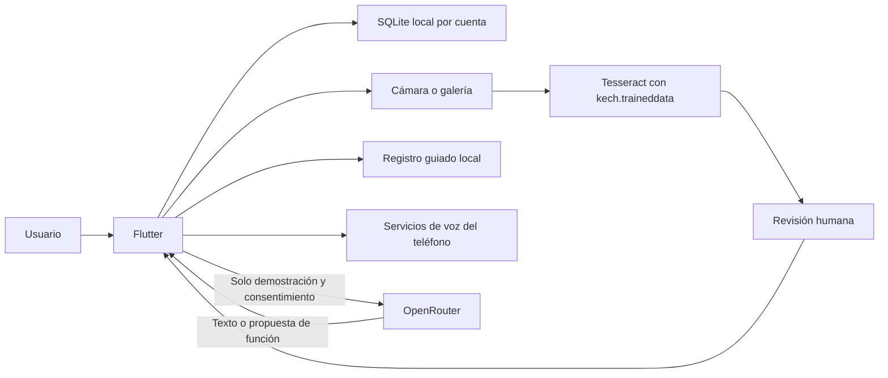

# Kech — Gestor de gastos y recibos

Kech es una aplicación Flutter para Android orientada a personas y pequeños negocios. Permite registrar gastos, fotografiar comprobantes, reconocer texto con Tesseract y consultar registros locales. Su asistente **Chequi** guía la captura mediante preguntas y ofrece una conexión de demostración con OpenRouter. La interfaz está en español y los importes se expresan en pesos mexicanos (MXN).

El proyecto se desarrolló sobre `kech_app` para un hackathon. Las pantallas usan widgets Flutter; los HTML de Stitch son referencias visuales.

> **Estado:** prototipo funcional con almacenamiento local. No tiene sincronización ni recuperación de cuentas. SQLite no está cifrado. La conversación remota está habilitada solo en debug y modo demostración con datos ficticios.

## Índice

- [Funciones y modos](#funciones-y-modos)
- [Instalación y ejecución](#instalación-y-ejecución)
- [Manual de uso](#manual-de-uso)
- [OCR y clasificación](#ocr-y-clasificación)
- [Asistente Chequi](#asistente-chequi)
- [Voz y dictado](#voz-y-dictado)
- [Arquitectura y rutas](#arquitectura-y-rutas)
- [Base de datos](#base-de-datos)
- [Seguridad y privacidad](#seguridad-y-privacidad)
- [Dependencias y recursos](#dependencias-y-recursos)
- [Compilación e instaladores](#compilación-e-instaladores)
- [Pruebas](#pruebas)
- [Solución de problemas](#solución-de-problemas)
- [Trabajo pendiente](#trabajo-pendiente)

## Funciones y modos

| Función | Cuenta local | Demostración |
| --- | --- | --- |
| Acceso | Registro e inicio de sesión | Botón disponible en debug |
| Gastos e imágenes | Persisten en SQLite por cuenta | Temporales en memoria |
| Registro manual y pagos mixtos | Disponible | Disponible |
| Cámara, galería y OCR Android | Disponible | Disponible |
| Historial, búsqueda, filtros y detalle | Disponible | Disponible |
| Registro guiado de Chequi | Local, sin API | Local, sin API |
| Lectura y dictado | Según servicios del teléfono | Según servicios del teléfono |
| Conversación vía OpenRouter | Deshabilitada | Requiere clave, internet y aceptación del aviso |

La demostración empieza sin gastos precargados. Las cuentas de negocio guardan el nombre del negocio; aún no incluyen empleados, roles ni contabilidad empresarial.

## Instalación y ejecución

### Requisitos de desarrollo

- Flutter compatible con **Dart `^3.14.0`**, según [pubspec.yaml](pubspec.yaml).
- Android Studio, Android SDK y herramientas de plataforma ADB.
- JDK compatible con Gradle; Android Studio incluye su propio JDK. El proyecto configura compatibilidad Java/Kotlin 17.
- Emulador Android o teléfono con depuración USB para desarrollo.
- Internet para descargar dependencias y componentes del SDK durante la primera compilación.

Android es la plataforma prioritaria. Las carpetas `ios/`, `web/`, `windows/`, `linux/` y `macos/` no implican soporte completo. El servicio OCR actual comprueba explícitamente que se ejecuta en Android.

Desde la raíz del proyecto:

```powershell
flutter --version
flutter doctor -v
flutter pub get
flutter analyze
flutter test
```

Si Windows informa que los plugins requieren enlaces simbólicos, activa el **Modo de desarrollador** del sistema y repite `flutter pub get`.

### Emulador

```powershell
flutter emulators
flutter emulators --launch Medium_Phone_API_37.0
flutter devices
flutter run -d emulator-5554
```

El nombre y el identificador son ejemplos de este entorno. Sustitúyelos por los que devuelvan los comandos en tu computadora. Espera a que el emulador termine de arrancar.

### Teléfono físico

1. Activa las opciones de desarrollador y la depuración USB.
2. Conecta el teléfono y autoriza la computadora en el diálogo de Android.
3. Ejecuta:

```powershell
flutter devices
flutter run -d ID_DEL_TELEFONO
```

Un APK ya instalado funciona sin computadora ni USB. El chat remoto requiere internet; las funciones locales pueden utilizarse sin conexión, salvo las dependencias del servicio de voz del teléfono.

## Manual de uso

### Cuentas

En **Crear cuenta**, completa nombre, apellidos, correo, usuario opcional y contraseña. Elige Personal o Negocio; este último requiere nombre del negocio. La contraseña debe tener al menos ocho caracteres y un número, coincidir con su confirmación y acompañarse de la aceptación de términos. El usuario opcional no puede contener `@`.

Los correos y usuarios se normalizan en minúsculas y no pueden repetirse. Tras registrarte, inicia sesión con correo o usuario y contraseña. No se envía correo de verificación. El control de términos es parte del prototipo y necesita textos legales definitivos antes de publicación.

La cuenta existe solo en la instalación actual. La sesión está en memoria: al reiniciar debes iniciar sesión otra vez, pero los gastos permanecen en SQLite. Cerrar sesión limpia la lista visible y el identificador activo.

**Olvidé mi contraseña** informa que la función está pendiente; no envía correos ni genera códigos. Actualmente no es posible recuperar una contraseña olvidada.

### Inicio

La barra inferior contiene **Inicio**, **Registros** y **Asistente**. El encabezado permite cerrar sesión.

Inicio muestra gastos con fecha del día local del teléfono, accesos a captura y registro manual y hasta tres movimientos recientes. **Tickets registrados** cuenta gastos con fotografía adjunta, no todos los gastos manuales sin imagen. Los valores provienen de la cuenta o sesión activa.

### Registro manual

Se solicitan monto, concepto, fecha, comercio, categoría y método de pago; la referencia es opcional. Puede guardarse sin fotografía.

El concepto comienza como **Compra** y es editable. El monto debe ser mayor a cero y tener hasta dos decimales. Se aceptan `120.50` y `120,50`; no se aceptan separadores de miles ni cantidades escritas con palabras. Los cálculos usan **centavos enteros**.

| Categorías | Métodos de pago |
| --- | --- |
| Alimentos | Efectivo |
| Insumos | Tarjeta de débito |
| Transporte | Tarjeta de crédito |
| Servicios | Transferencia |
| Operación | Billetera digital |
| Otros | Pago mixto |
| | Desconocido |

En **Pago mixto**, introduce importes para al menos dos métodos. La suma debe coincidir exactamente con el total. El formulario espera a que SQLite complete la escritura antes de mostrar éxito y deshabilita Guardar durante esa operación. En demostración indica que el gasto solo pertenece a la sesión temporal.

### Cámara, galería y revisión

1. Abre **Escanear nuevo ticket**.
2. Pulsa **Abrir cámara** o **Seleccionar de galería**.
3. Captura o elige la imagen.
4. Revisa la fotografía, texto OCR y sugerencias.
5. Pulsa **Revisar y registrar gasto**, corrige los campos y guarda.

La captura usa la cámara o el selector del sistema; el recuadro de Kech no es una cámara personalizada. Cancelar no crea registros. La app intenta recuperar la selección si Android destruye su actividad mientras se utiliza el selector. Ante un fallo OCR permite reintentar o continuar manualmente.

### Historial

Registros permite buscar por comercio o concepto y filtrar por fechas, categoría y método de pago. El resumen corresponde a los resultados filtrados. Al pulsar un movimiento se muestran datos, desglose mixto, fotografía y sugerencias OCR conservadas.

El detalle es de consulta: no hay edición o eliminación de registros guardados. El origen visible usa **Manual** o **Manual con foto**, incluso si hubo sugerencias OCR; estas se consultan en el detalle.

## OCR y clasificación

### Modelo y recursos

Tesseract se ejecuta en Android mediante `tesseract_ocr` con `language: 'kech'`. No requiere servidor OCR ni instalación de Tesseract en Windows.

- Modelo original: `referencias/kech.traineddata`.
- Copia incluida en el APK: `assets/tessdata/kech.traineddata`.
- Lista de modelos: `assets/tessdata_config.json`.
- Implementación: [ocr_service.dart](lib/features/receipts/ocr_service.dart).

La imagen se escribe en un directorio temporal de la app para el motor; ese directorio se elimina al terminar el intento. La imagen del gasto confirmado se guarda posteriormente como BLOB en SQLite.

Para actualizar el modelo, sustituye la copia de `assets/tessdata/kech.traineddata` y conserva su correspondencia con el nombre del idioma y la configuración. El plugin copia modelos al almacenamiento de la app; durante desarrollo puede ser necesario limpiar esa copia para probar un reemplazo. **Borrar los datos de la app también elimina cuentas y gastos**. No hay versionado propio de modelos instalados.

### Extracción e incertidumbre

El modelo reconoce texto; las reglas Dart interpretan sus campos:

| Campo | Regla actual |
| --- | --- |
| Total | Línea completa con Total, Total a pagar, Gran total o Importe total y un importe decimal. Valores distintos quedan sin sugerencia. |
| Fecha | Fecha numérica día/mes/año en una línea con Fecha; valida calendario y años entre 2000 y 2100. |
| Comercio | Primera línea no vacía que cumpla la regla de encabezado en mayúsculas; excluye etiquetas genéricas como Ticket o Recibo. |
| Folio | Línea de Folio o Referencia con contenido alfanumérico o guiones; conflictos quedan sin sugerencia. |
| Pago | Etiquetas explícitas de forma/método/medio de pago o una línea completa de Tarjeta débito/crédito. Tarjeta genérica queda desconocida. |
| Productos | Líneas con cantidad, multiplicador, descripción e importe: `2 x Estambre azul $41.94`. |
| Categoría | Diccionario local: todos los productos extraídos deben coincidir inequívocamente con una misma categoría. |

Ejemplos: limón, jícama y piña → **Alimentos**; estambre y cierre metálico → **Insumos**. Productos desconocidos, coincidencias múltiples o categorías mezcladas requieren selección manual. La clasificación es una heurística local, no un clasificador universal entrenado.

Las reglas no cubren todos los formatos, abreviaturas, columnas o separadores de miles. La revisión humana es obligatoria. Un ticket y su método de pago no prueban una liquidación bancaria; el detalle muestra el estado de liquidación como no indicado.

El filtro de texto omite líneas con CVV/CVC/NIP/PIN y posibles secuencias numéricas sensibles. Es una protección por patrones, no una garantía de anonimización. **No censura la fotografía original**. Evita capturar comprobantes con datos sensibles completos.

## Asistente Chequi

### Registro guiado local

Disponible en cuentas locales y en demostración, sin clave ni internet. Es un cuestionario implementado en Dart; no llama a un modelo remoto.

Escribe **registrar gasto** o pulsa **Ayúdame a registrar un gasto**. Pregunta, en orden:

1. Monto en MXN.
2. Comercio o proveedor.
3. Fecha: `hoy`, `ayer` o `DD/MM/AAAA`.
4. Categoría: número o nombre de opción.
5. Método de pago: número o nombre de opción.
6. Concepto: `sí` conserva Compra; otro texto lo sustituye.
7. Referencia: folio u `omitir`.

Las respuestas inválidas mantienen la pregunta. Durante la captura puedes escribir **cancelar**. Al terminar aparece un resumen y **Revisar formulario**: corrige lo necesario, selecciona y confirma la fecha y pulsa Guardar. Los pagos mixtos se desglosan en ese formulario.

No se guardan gastos al responder. No hay persistencia del chat ni una función para retroceder dentro del cuestionario; puedes cancelar y empezar de nuevo o corregir en el formulario final. Salir de la pantalla descarta la conversación y el borrador todavía no guardado.

### Conversación remota

Conexión directa HTTPS desde Flutter:

```text
POST https://openrouter.ai/api/v1/chat/completions
Modelo: nvidia/nemotron-3.5-lightning:free
```

Solo se habilita en **debug y modo demostración**. No se habilita para cuentas normales. La disponibilidad y las cuotas del proveedor pueden cambiar. Consulta la [ficha y condiciones del modelo](https://openrouter.ai/nvidia/nemotron-3.5-lightning:free): el endpoint se utiliza únicamente con datos ficticios, sin información personal o financiera real.

Para configurarlo, abre Asistente en demostración, introduce tu clave en **Clave API de OpenRouter**, acepta el aviso y escribe una consulta. No necesitas una computadora conectada, un puente USB ni Node.js.

La clave permanece en memoria en el controlador de la pantalla y se envía a OpenRouter en la cabecera de autorización HTTPS. No se incorpora al código, al APK o a SQLite; se descarta al salir de la pantalla. No la compartas por chat ni la agregues a archivos versionados.

| Función propuesta por el modelo | Comportamiento de Flutter |
| --- | --- |
| `consultar_gastos` | Valida filtros y calcula un total o lista de los últimos cinco gastos de la sesión. |
| `preparar_gasto` | Valida la propuesta; la interfaz inicia el registro guiado para completar y confirmar datos. |

Las consultas admiten periodos hoy, semana, mes y todos, categoría y filtros de pago. La semana empieza el lunes; los periodos relativos llegan hasta el día actual del teléfono. En totales de tarjeta, un pago mixto aporta solo su parte de tarjeta; la lista de últimos gastos muestra el importe completo del movimiento.

Flutter rechaza funciones desconocidas, argumentos inválidos o múltiples llamadas simultáneas. El modelo no accede directamente a SQLite ni ejecuta SQL. Las respuestas de consulta se calculan localmente; la conversación general se identifica como respuesta de IA sin consulta de registros.

Se envían instrucciones, herramientas y una ventana limitada del historial. No se incluyen automáticamente registros, fotos, texto OCR, contraseñas o resultados locales. **Los mensajes escritos por el usuario sí se envían**. Hay manejo de rechazo de clave, límites, respuestas incompletas y errores de conexión.

### Puente anterior

`chequi_bridge/` contiene un prototipo Node.js anterior y sus pruebas. El Flutter actual ya no se conecta a él. Se conserva como referencia, no como backend de producción. `server.cjs` requiere `OPENROUTER_API_KEY` y `CHEQUI_BRIDGE_TOKEN` en su entorno y escucha solo en `127.0.0.1:8787`. `mock_server.cjs` devuelve una respuesta fija y no representa conversación real.

Prueba aislada del puente, con Node.js 18 o superior y sin clave real:

```powershell
node --test chequi_bridge/server_test.cjs
```

## Voz y dictado

`speech_to_text` y `flutter_tts` adaptan los servicios del teléfono. No se empaqueta un modelo adicional ni hace falta activar TalkBack.

- El micrófono está a la izquierda de la barra de mensajes. Al primer uso solicita permiso de audio.
- Durante el dictado se actualiza el campo de texto. Pulsa de nuevo para detenerlo, revisa y envía manualmente.
- El dictado no pulsa Enviar ni guarda gastos automáticamente.
- Leer respuestas en voz alta está activado inicialmente; puede desactivarse.
- Detener voz interrumpe la lectura y el altavoz de cada respuesta permite repetirla.
- Los servicios se detienen al salir, pasar a segundo plano o abrir el formulario.

Se prefiere español de México; si falta, se utiliza otra variante de español instalada. Se solicitan hasta 40 segundos de escucha y una pausa de 4 segundos, aunque Android puede finalizar antes. Bluetooth está deshabilitado en la configuración de reconocimiento de esta versión.

La voz depende del motor TTS y sus paquetes de idioma. El reconocimiento **puede utilizar internet y servicios externos del proveedor del teléfono**. No se garantiza funcionamiento sin conexión. Si el dictado produce palabras en lugar de un importe numérico o una fecha válida, corrige el campo antes de enviarlo.

## Arquitectura y rutas

```text
lib/
├── main.dart                       # Punto de entrada
├── app/app.dart                    # Tema, localización y GoRouter
├── core/local_store.dart           # SQLite, contraseñas y sesión
├── shared/ui.dart                  # Componentes y formatos comunes
└── features/
    ├── auth/auth.dart              # Acceso, registro y recuperación pendiente
    ├── home/home.dart              # Resumen y actividad reciente
    ├── expenses/
    │   ├── model.dart              # Expense, Riverpod y centavos
    │   └── expenses.dart           # Formulario, historial y detalle
    ├── receipts/
    │   ├── receipts.dart           # Captura, selección y revisión
    │   └── ocr_service.dart        # Tesseract y reglas de extracción
    └── assistant/
        ├── assistant.dart         # Chat y controles
        ├── assistant_service.dart # OpenRouter y consultas locales
        ├── guided_expense.dart    # Cuestionario local
        └── voice_service.dart     # Dictado y lectura
```

| Ruta | Pantalla |
| --- | --- |
| `/` | Iniciar sesión |
| `/crear` | Crear cuenta |
| `/recuperar` | Recuperación pendiente |
| `/inicio` | Inicio |
| `/registros` | Historial y filtros |
| `/asistente` | Chequi |
| `/gasto` | Formulario manual o revisión final |
| `/escanear` | Cámara/galería |
| `/revisar` | Revisión OCR |

GoRouter redirige al acceso si no existe sesión. Riverpod conserva la lista visible; `ExpenseStore` carga la cuenta al iniciar sesión y espera la escritura antes de añadir un movimiento. `LocalStore` comunica cambios de sesión al router. Las rutas reciben borradores e imágenes en memoria; no son enlaces permanentes a un ticket.



## Base de datos

La base **`kech.db`**, esquema versión **1**, se abre mediante `sqflite` en el directorio de bases de datos de la aplicación. En Android su ubicación depende del usuario y del dispositivo; no se guarda en `referencias/` ni en una carpeta pública del teléfono.

### Tabla `users`

| Columna | Tipo | Uso |
| --- | --- | --- |
| `id` | INTEGER, clave primaria | Identidad local |
| `name`, `surname` | TEXT, NOT NULL | Nombre y apellidos |
| `email` | TEXT, NOT NULL, UNIQUE | Correo normalizado |
| `username` | TEXT, UNIQUE, admite NULL | Usuario opcional normalizado |
| `business` | INTEGER, NOT NULL | 0 Personal, 1 Negocio |
| `business_name` | TEXT | Nombre del negocio |
| `salt`, `hash` | BLOB, NOT NULL | Sal aleatoria y resultado Argon2id |

### Tabla `expenses`

| Columna | Tipo | Uso |
| --- | --- | --- |
| `id` | INTEGER, clave primaria | Orden de registro |
| `user_id` | INTEGER, NOT NULL, clave foránea | Cuenta propietaria |
| `cents` | INTEGER, NOT NULL | Importe en centavos |
| `concept`, `merchant`, `category`, `payment`, `reference` | TEXT, NOT NULL | Datos confirmados |
| `date` | TEXT, NOT NULL | Fecha ISO 8601 |
| `parts` | TEXT, NOT NULL | JSON con importes por método en centavos |
| `image` | BLOB, admite NULL | Imagen adjunta |
| `recognized_text` | TEXT, admite NULL | Texto OCR filtrado |
| `suggested_total`, `suggested_date`, `suggested_payment` | TEXT, admite NULL | Sugerencias originales |
| `suggested_merchant`, `suggested_reference`, `suggested_category` | TEXT, admite NULL | Otras sugerencias OCR |

Se habilitan claves foráneas y `user_id` referencia a `users(id)` con `ON DELETE CASCADE`. No existe interfaz para eliminar cuentas. Las consultas usan parámetros y filtran por el identificador de la sesión. Las sugerencias permiten compararlas con los datos confirmados; no constituyen un historial completo de cada edición.

La demostración utiliza un identificador interno especial y omite las escrituras de gastos en SQLite. Sus datos no se migran a una cuenta normal al registrarse. Para evolucionar el esquema, incrementa la versión y añade migraciones en `LocalStore`; no borres la base como estrategia de actualización de usuarios reales.

## Seguridad y privacidad

- Contraseñas derivadas con **Argon2id**, sal aleatoria de 16 bytes, memoria de 19 456 KiB, dos iteraciones, paralelismo 1 y salida de 32 bytes. El cálculo se ejecuta con `compute`, separado del hilo de interfaz.
- No se almacena la contraseña original. Los parámetros están fijados en código; una evolución del formato debe versionar las derivaciones para conservar las cuentas anteriores.
- La separación de cuentas es lógica dentro de la app. **SQLite y las imágenes no están cifrados**; el aislamiento de Android no equivale a protección frente a un dispositivo comprometido o acceso privilegiado.
- Android tiene `allowBackup="false"`. No hay exportación ni copias gestionadas por Kech. Desinstalar o borrar datos elimina cuentas y tickets.
- No hay autenticación remota, bloqueo por intentos, verificación de correo, cambio o recuperación de contraseña.
- El OCR y la clasificación pueden equivocarse. Toda escritura exige revisión y acción del usuario.
- El método de pago no confirma liquidación. La app no verifica transacciones bancarias.
- El filtro sensible del texto no anonimiza fotografías ni garantiza eliminar toda información confidencial.
- El chat remoto y la voz tienen condiciones de tratamiento de datos propias. El registro guiado local no envía sus respuestas al modelo.

| Permiso o servicio Android | Motivo |
| --- | --- |
| `INTERNET` | OpenRouter y posibles servicios de reconocimiento |
| `RECORD_AUDIO` | Micrófono, solicitado al utilizar dictado |
| Micrófono opcional | Permite instalar sin ese hardware |
| Consulta `RecognitionService` | Descubrimiento del servicio de dictado |
| Consulta `TTS_SERVICE` | Descubrimiento del motor de lectura |

Cámara y galería se abren mediante `image_picker` y los selectores del sistema. No se añade acceso general al almacenamiento del teléfono.

## Dependencias y recursos

Los rangos declarados están en `pubspec.yaml`; las versiones resueltas están fijadas en `pubspec.lock`.

| Dependencia | Uso |
| --- | --- |
| `flutter`, `flutter_localizations` | Interfaz y localización española |
| `material_ui`, `cupertino_ui` | Componentes y soporte de la versión Flutter utilizada |
| `flutter_riverpod` | Estado de gastos |
| `go_router` | Navegación y redirecciones |
| `intl` | Moneda y fechas `es_MX` |
| `image_picker` | Cámara y galería |
| `tesseract_ocr` | Motor OCR nativo |
| `path_provider`, `path` | Directorios temporales y rutas |
| `sqflite` | SQLite |
| `cryptography` | Argon2id |
| `http` | Peticiones HTTPS |
| `speech_to_text` | Dictado |
| `flutter_tts` | Lectura con el motor del teléfono |
| `flutter_test`, `integration_test` | Pruebas de código, widgets y Android |
| `flutter_lints` | Análisis estático |
| `flutter_launcher_icons` | Generación de iconos, solo desarrollo |

No se requiere Python, FastAPI ni Node.js para ejecutar la aplicación actual. El diseño original contempla Python/FastAPI para una futura API; ese backend todavía no está implementado.

### Diseño visual

La tipografía **Plus Jakarta Sans** se incluye localmente en `assets/PlusJakartaSans.ttf`; su licencia está en `assets/PlusJakartaSans-OFL.txt`.

| Color | Valor |
| --- | --- |
| Azul Bruma | `#8FAFC8` |
| Verde Salvia | `#A6C8B4` |
| Botón azul | `#526F8D` |
| Botón verde | `#5F927B` |
| Fondo | `#F3F7FA` |
| Tarjetas | `#FFFFFF` |
| Texto | `#1C2B43` |
| Bordes | `#CDD9E6` |

Las referencias están en `referencias/stitch_kech_gestor_de_gastos/`, con siete pantallas `screen.png` y `code.html` y el sistema visual `serene_ledger/DESIGN.md`. `referencias/boceto_kech.jpeg` conserva el boceto de navegación.

El logotipo original es `referencias/Kech logo.jpeg`; `assets/kech_logo.jpeg` es la copia usada en la interfaz y los iconos. `flutter_launcher_icons` genera iconos Android tradicionales y adaptables. Después de sustituir ese recurso, ejecuta:

```powershell
dart run flutter_launcher_icons
```

Los recursos generados están en `android/app/src/main/res/`. La configuración actual no genera iconos iOS.

## Compilación e instaladores

```powershell
flutter pub get
flutter analyze
flutter test
flutter build apk --debug
```

APK generado: `build/app/outputs/flutter-apk/app-debug.apk`.

Para conservar una copia de presentación:

```powershell
New-Item -ItemType Directory -Force instaladores | Out-Null
Copy-Item -LiteralPath build/app/outputs/flutter-apk/app-debug.apk -Destination instaladores/Kech-presentacion-debug.apk -Force
```

`instaladores/` contiene versiones históricas. **`Kech-icono-debug.apk`** es el instalador generado en la última actualización del icono e incluye las funciones implementadas hasta ese momento. Otros nombres corresponden a versiones anteriores. Los APK no se actualizan al editar código: recompila para obtener el estado actual.

Para instalar por ADB, con el teléfono autorizado:

```powershell
& "$env:LOCALAPPDATA\Android\Sdk\platform-tools\adb.exe" install -r instaladores/Kech-presentacion-debug.apk
```

También puedes copiar el archivo al teléfono y abrirlo desde su gestor de archivos, permitiendo esa fuente de instalación cuando Android lo solicite. Una actualización con firma e identificador compatibles conserva los datos. No desinstales como primer paso si necesitas conservar los registros.

El identificador Android es `mx.kech.kech_app`; la versión declarada es `1.0.0+1`. `minSdk`, `targetSdk`, `compileSdk` y NDK heredan valores de Flutter. En las compilaciones de prueba realizadas se observó un mínimo Android API 24; verifica los requisitos de un nuevo APK al cambiar Flutter o plugins.

Debug habilita el acceso de demostración. En release ese acceso y la conexión gratuita a OpenRouter quedan deshabilitados; el registro guiado local no depende de esa conexión. La configuración release actual utiliza la **firma debug** y no está preparada para publicar en tienda. Configura firma y medidas de producción antes de distribuir una versión pública.

## Pruebas

### Código y widgets

```powershell
flutter analyze
flutter test
```

| Archivo | Cobertura principal |
| --- | --- |
| `test/widget_test.dart` | Extracción de ejemplos, incertidumbre, filtrado sensible, importes, navegación, registro demo y posición del micrófono |
| `test/assistant_service_test.dart` | OpenRouter simulado, rechazo de clave, restricción a demo, filtros, totales y pagos mixtos |
| `test/guided_expense_test.dart` | Preguntas por pasos, respuestas inválidas, resumen y cancelación |

Las respuestas remotas se simulan con `MockClient`. Estas pruebas no validan una clave real, disponibilidad del endpoint, audio real ni la precisión del OCR sobre todos los tickets.

### Integración Android

Inicia un emulador o conecta un teléfono y sustituye el identificador si corresponde:

```powershell
flutter test integration_test/ocr_test.dart -d emulator-5554
flutter test integration_test/local_store_test.dart -d emulator-5554
flutter test integration_test/assistant_test.dart -d emulator-5554
```

- OCR: construye una imagen sintética y comprueba que el modelo devuelve texto no vacío. No es una evaluación de precisión con tickets reales.
- Almacenamiento: crea cuentas de prueba únicas, verifica credenciales y separación de gastos con imagen y elimina esas cuentas al terminar. No elimina cuentas existentes.
- Asistente: ejecuta el servicio en Android con una respuesta HTTP simulada, sin contactar OpenRouter ni necesitar una clave real.

Las pruebas de integración instalan una aplicación de pruebas. Reinstala el APK normal si después quieres realizar la presentación; no distribuyas el APK generado para pruebas de integración.

En las verificaciones anteriores de implementación pasaron el análisis, las 14 pruebas de código/widgets y la compilación debug. También se ejecutaron previamente pruebas de integración de OCR y almacenamiento. No se ha comprobado desde este entorno una llamada real con la clave del usuario ni el audio de su teléfono. La edición de este README es documental y no implica una nueva ejecución de esas verificaciones.

## Solución de problemas

| Problema | Comprobaciones |
| --- | --- |
| No aparece el teléfono | Cable, depuración USB, autorización, controladores y `flutter devices`. |
| No aparece el emulador | Espera su arranque y revisa el nombre con `flutter emulators`. |
| Faltan componentes Android | Usa `flutter doctor -v` y SDK Manager para instalar las versiones que pide Gradle. Evita cambiar versiones solo para ocultar el error. |
| Error de NDK | Este entorno requirió `28.2.13676358`. Instala la versión solicitada por tu Flutter. Algunos envoltorios nuevos de SDK Manager usan la ruta `ndk/28.2.13676358` en Android CLI. |
| Error de symlinks en Windows | Activa Modo de desarrollador y repite `flutter pub get`. |
| No abre cámara o galería | Comprueba las aplicaciones/selectores del sistema y vuelve a intentar o registra manualmente. |
| OCR vacío o incorrecto | Usa una fotografía completa, nítida y bien iluminada. Reintenta y corrige manualmente. Si siempre falla, revisa el empaquetado del modelo. |
| No sugiere categoría | Puede haber artículos desconocidos, categorías mezcladas o líneas incompatibles. Selecciona manualmente y amplía las reglas con pruebas. |
| No guarda el gasto | Revisa campos obligatorios, categoría, confirmación de fecha del asistente, suma de pagos mixtos y espacio disponible. |
| No aparecen gastos | Comprueba cuenta y modo. No hay sincronización entre teléfonos; la demostración no persiste. |
| Clave rechazada | Comprueba el valor introducido y el acceso al modelo en OpenRouter. La clave se descarta al salir del chat. |
| Límite de OpenRouter | Espera y revisa las cuotas de tu cuenta. No existen reintentos automáticos ilimitados. |
| En cuenta normal solo funciona el registro guiado | Es el alcance actual: conversación remota restringida a demostración. |
| No funciona el micrófono | Concede audio y comprueba que exista reconocimiento con español instalado. |
| No se oye a Chequi | Revisa volumen, Leer respuestas en voz alta, motor TTS y voces de español. No necesitas activar TalkBack. |
| El dictado cambia el importe | Corrige la transcripción al formato numérico antes de enviarla y verifica el resumen. |
| Icono anterior | Instala el APK actualizado y vuelve a abrir el lanzador; puede conservar caché. Evita borrar los datos de Kech como primera solución. |
| Advertencia Kotlin de `flutter_tts` | La compilación utilizada aceptó el plugin con aviso de compatibilidad futura. Revisa actualizaciones antes de actualizar Flutter. |

## Trabajo pendiente

1. Cifrado, exportación y copias de seguridad con restauración verificable.
2. Recuperación/cambio de contraseña, verificación de cuenta y protección de acceso más completa.
3. Edición/eliminación de gastos y cuentas, con confirmación y migraciones del esquema.
4. Ampliar formatos OCR, importes y fechas, clasificación y evaluación con tickets representativos.
5. Versionado de `kech.traineddata` instalado en el dispositivo.
6. API remota autenticada, protección de claves en servidor y condiciones adecuadas para datos financieros.
7. Correcciones dentro del cuestionario, borradores persistentes e interpretación de transcripciones más flexible.
8. Validar audio, permisos, accesibilidad, escalas de texto y distintas resoluciones en varios teléfonos reales.
9. Firma de producción, revisión de dependencias y términos/política de privacidad definitivos.

No se declara todavía una licencia general de distribución de la aplicación. Revisa los derechos del logotipo y el modelo, y las licencias de dependencias y tipografía antes de redistribuirlos.
